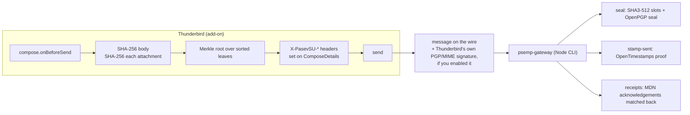

# PasevSU Forensic Mail Engine — Thunderbird

**Every message you send from Thunderbird leaves with a cryptographic fingerprint of itself and of every file attached to it — computed at send time, with nothing to click and nothing to remember.**

[](LICENSE)
[-1e73be.svg)](INSTALL.md)
[](CHANGELOG.md)
[](https://github.com/PasevSU/ForensicMail_Engine-Thunderbird/actions/workflows/checks.yml)

---

## The rule this project exists to satisfy

> **трябва да се създават стандартно винаги** — the headers must be produced by default, always, with no per-message opt-in.

That sentence is the whole design brief, and it is enforced structurally rather than by good intentions:

- The add-on hooks `compose.onBeforeSend`, which Thunderbird calls on **every** send — there is no code path that skips it.
- The hook never returns `{ cancel: true }`. It cannot block your mail; it can only add to it.
- The identity headers are **not settings**. There is no switch that turns `X-PasevSU-WAR`, the evidence id, the body digest or the Merkle root off.
- If anything inside the hook throws, the message is still sent — unchanged, without the extra headers — because a mail client that silently loses mail is worse than one that misses a header. The failure is reported in the options page instead.

Everything optional (`caseId`, PGP fingerprint, the OpenTimestamps marker, the delivery-receipt request) defaults to *on where that is safe*, and is written only when it can be written honestly.

---

## Two halves, one chain

A Thunderbird MailExtension runs inside a sandbox with no filesystem, no shell, no keyring access and no network primitives of its own. Some of what this project promises therefore **cannot** happen inside the add-on. Rather than pretend otherwise, the work is split, and the split is visible in the headers:



| Half | Runs in | Can do | Cannot do |
| --- | --- | --- | --- |
| `thunderbird-extension/` | Thunderbird 115+ | Web Crypto digests, ComposeDetails headers, `returnReceipt`, local settings | read the OpenPGP keyring, write arbitrary non-`X-` headers, write files, reach the network |
| `psemp-gateway/` | Node ≥ 20, on your machine | SHA3-512, OpenPGP sign/verify via `gpg`, real OpenTimestamps, receipt matching, manifests | send mail — it has no transport, by design |

The two halves agree on one normative document: [`psemp-gateway/PROTOCOL.md`](psemp-gateway/PROTOCOL.md) (the PSEMP specification). The header reference derived from it is [`HEADERS.md`](HEADERS.md).

---

## What lands on every message

The add-on writes these on **every** send. Conditions in the last column are about *honesty*, not opt-in — a header is omitted only when writing it would be a lie or would be blank.

| Header | Value | When |
| --- | --- | --- |
| `X-PasevSU-Version` | framework version (default `1.0`) | always |
| `X-PasevSU-Build` | add-on build id | always (when a build id exists) |
| `X-PasevSU-Framework` | `Forensic-Mail` | always |
| `X-PasevSU-Origin` | `Thunderbird` | always |
| `X-PasevSU-Organization` | `PasevSU` | always |
| `X-PasevSU-WAR` | the no-forwarding / provenance statement | always |
| `X-PasevSU-Evidence-ID` | UUID v4 for this message | always |
| `X-PasevSU-Body-SHA256` | SHA-256 of the plain-text body | always |
| `X-PasevSU-Attachments-Count` | number of files | always |
| `X-PasevSU-Manifest-SHA256` | SHA-256 of the manifest text | always |
| `X-PasevSU-Merkle-Root` | root over body + every attachment digest | always |
| `X-PasevSU-Message-ID` | generated long Message-ID | always |
| `X-PasevSU-Sha256` | readable digest block | always |
| `X-PasevSU-Cripto-Engine` | 25-digit engine code | always |
| `X-PasevSU-Cripto-title` | digest block encrypted under the engine code | always |
| `X-PasevSU-Case-ID` | your case label | only when set |
| `X-PasevSU-Attachments-SHA256` | `name=hash` list | only when files exist |
| `X-PasevSU-Attachment-<n>` | one header per file | only when files exist |
| `X-PasevSU-Attachments-Error` | files attached but unreadable | only when reading failed |
| `X-PasevSU-PGP-Fingerprint` | claimed signer fingerprint | only when configured |
| `X-PasevSU-OTS` | `pending` (marker) | on by default |
| `X-PasevSU-Receipt` | `requested` | on by default |
| `X-PasevSU-Created` / `-Expires` | issue window | always |
| `X-PasevSU-Nonce` / `-Sequence` | replay defence | always |
| `X-PasevSU-Canary` | leak-tracing value | always |
| `X-PasevSU-Headers-SHA256` | digest of the signed metadata | always |

The full twenty-seven-name contract, with the exact meaning and the verification command for each, is in **[`HEADERS.md`](HEADERS.md)**.

The companion `Disposition-Notification-To` field is written by Thunderbird itself, because a MailExtension may not set it — see [Why some things must happen outside the add-on](#why-some-things-must-happen-outside-the-add-on).

---

## Install in five minutes

### 0. Or take the built artifact

The current `.xpi` is attached to
[**Releases**](https://github.com/PasevSU/ForensicMail_Engine-Thunderbird/releases/latest)
with its SHA-256 in the release notes, so you can confirm the file you downloaded
without trusting the download. Check it before installing:

```powershell
certutil -hashfile pasevsu-forensic-headers@pasev.example-1.9.xpi SHA256
```

It is **unsigned**, and Thunderbird refuses unsigned add-ons by default. Installing
it permanently therefore still needs the preferences that step 2 applies — which is
why the installer remains the supported route. The artifact is there so you can
compare it against your own build and know when they differ.

### 1. The add-on, temporarily (works right now)

1. Thunderbird → **☰ → Add-ons and Themes** → gear icon → **Debug Add-ons**.
2. **Load Temporary Add-on…** → select `thunderbird-extension/manifest.json`.
3. Compose a message and send it to yourself. Open the received copy → **More → View Source** (`Ctrl+U`) → the `X-PasevSU-*` block is at the top.

Temporary add-ons vanish when Thunderbird restarts. For a permanent install use the script below.

### 2. The add-on, permanently (recommended)

```powershell
# Windows, Thunderbird closed. Builds the .xpi, installs it into the profile
# and registers the 27 header names in the profile's user.js.
powershell -ExecutionPolicy Bypass -File thunderbird-extension\tools\install.ps1
```

The script refuses to write over a locked file and exits with code `2` in that case. Full options, the manual route and the uninstall steps are in **[`INSTALL.md`](INSTALL.md)**.

> **Why `user.js` matters:** Thunderbird will not recognise an arbitrary custom header when it *displays* or *forwards* a message unless the name is listed in `mail.compose.other.header`. The add-on can set the headers regardless, but registering them is what makes them survive the round trip.

### 3. Prove that it worked

```bash
node psemp-gateway/tools/verify-install.cjs "C:\Users\<you>\AppData\Roaming\Thunderbird\Profiles\xxxxxxxx.default-esr"
node psemp-gateway/cli.js self-test
node psemp-gateway/tools/check-sent.cjs "C:\...\Profiles\xxxxxxxx.default-esr"
```

`verify-install` answers "is the loaded add-on the source in this repository?", `check-sent` answers "did the last message I actually sent carry the headers and the signature, and were the files inside the signature?", and `self-test` runs the known-answer vectors for the digests and the OpenPGP/OTS bridges.

---

## Why some things must happen outside the add-on

These are platform limits of MailExtensions (Thunderbird 115), not missing features:

| Wish | Reality inside a MailExtension | What this project does instead |
| --- | --- | --- |
| Real OpenTimestamps proof | No filesystem, no HTTP from the compose hook | `X-PasevSU-OTS: pending` is written **as a marker only**; `psemp-gateway stamp-sent` finds the sent message, re-verifies its chain and writes the real `.ots` proof |
| PGP-signing the whole message | The add-on cannot read the keyring and cannot sign | Enable *Digitally sign messages* in the account's End-to-End Encryption settings — Thunderbird then applies PGP/MIME itself. `X-PasevSU-PGP-Fingerprint` is a **claim**, which `psemp-gateway pgp-check` compares with the signer actually found |
| `Disposition-Notification-To` | `customHeaders` rejects any name not starting with `X-`, and a rejected `setComposeDetails()` aborts the send silently | The add-on sets `details.returnReceipt = true`; Thunderbird writes the standard field |
| SHA3-512 / BLAKE digests | Web Crypto in Thunderbird exposes SHA-1/256/384/512 only | The add-on computes SHA-256 and the Merkle root; `seal` fills the SHA3-512 slots afterwards |
| Writing an `.eml` or a manifest to disk | No filesystem access | The manifest digest is carried in the headers (`-Manifest-SHA256`); `psemp-gateway` rebuilds and stores the manifest |

**A delivery receipt is a courtesy, not a guarantee.** `X-PasevSU-Receipt: requested` plus the MDN field ask the recipient's client to acknowledge; a client may ignore the request and a gateway may strip it. `psemp-gateway receipts` reports an absent acknowledgement as **unknown**, never as non-delivery, and counts one acknowledgement once however many folders its copies occupy.

---

## Repository map

```
thunderbird-extension/        the MailExtension (loaded by Thunderbird, no build step)
  manifest.json               MV2, id pasevsu-forensic-headers@pasev.example, min TB 115.0
  background.js               compose.onBeforeSend -> digests -> Merkle root -> headers
  options.html / options.js   every setting the add-on reads: the chain identity
                              (version, caseId, messageIdDomain, manifestFilename,
                              manifestFramework, manifestStandard), the published
                              algorithms (algoBody, algoExtra, algoMerkle, algoEngine,
                              algoSignature, algoTimestamp), the signer wording
                              (pgpSigner, pgpStandard, pgpFingerprint) and the two
                              receipts (enableReceipt/MDN, enableDeliveryReceipt/DSN,
                              receiptMode, receiptAddress) — 23 keys in all
  user.js                     the 27 names, for mail.compose.other.header
  _locales/{en,bg,de}/        UI strings
  tools/install.ps1           build .xpi + install + register names (Windows)
  README.md                   the add-on's own documentation

psemp-gateway/                the CLI half (Node >= 20, zero runtime dependencies)
  api.js                      the engine: digests, Merkle, manifests, OTS bridge, OpenPGP
  cli.js                      status, hash, evidence, eml, stamp, verify, sign, seal, receipts, ...
  PROTOCOL.md                 the normative PSEMP specification
  tools/                      check-sent, check-receipts, verify-install
  test/                       13 suites, run with node psemp-gateway/test/all.cjs
  packages/                   vendored crypto/OTS code (LGPL-3.0 - see THIRD_PARTY.md)

tools/check-repo.cjs          consistency gate: LF, versions, header parity, no Node in the add-on
docs/                         CLI reference, verification walkthrough, threat model
```

---

## Documentation

| Document | Answers |
| --- | --- |
| [`HEADERS.md`](HEADERS.md) | every header, its exact value format, and how to verify it |
| [`INSTALL.md`](INSTALL.md) | permanent install, manual install, uninstall, troubleshooting |
| [`ARCHITECTURE.md`](ARCHITECTURE.md) | how the pieces fit, what runs where, and why the split is where it is |
| [`docs/CLI.md`](docs/CLI.md) | every `psemp-gateway` command with its flags and output |
| [`docs/VERIFICATION.md`](docs/VERIFICATION.md) | end-to-end: send a message, prove what it carries |
| [`docs/THREAT-MODEL.md`](docs/THREAT-MODEL.md) | what an attacker can and cannot do, and what this does *not* protect against |
| [`psemp-gateway/PROTOCOL.md`](psemp-gateway/PROTOCOL.md) | the normative specification (PSEMP 1.1) |
| [`thunderbird-extension/README.md`](thunderbird-extension/README.md) | the add-on, on its own |
| [`SECURITY.md`](SECURITY.md) · [`PRIVACY.md`](PRIVACY.md) · [`CONTRIBUTING.md`](CONTRIBUTING.md) · [`CHANGELOG.md`](CHANGELOG.md) | policy, data handling, how to help, what changed |
| [`CITATION.cff`](CITATION.cff) · [`CODE_OF_CONDUCT.md`](CODE_OF_CONDUCT.md) · [`THIRD_PARTY.md`](THIRD_PARTY.md) · [`NOTICE`](NOTICE) | how to cite the version that produced an artefact, conduct, and the licence position |

---

## Requirements and compatibility

- **Thunderbird 115.0 or newer** (including 115 ESR, 128 ESR and later). The manifest declares `strict_min_version: "115.0"`.
- **Windows, macOS or Linux** for the add-on. `install.ps1` is Windows-only; on other platforms load the add-on manually — see [`INSTALL.md`](INSTALL.md).
- **Node.js 20 or newer** for the gateway half only. The add-on itself needs no Node, no npm and no build step.
- `gpg` is needed for the OpenPGP commands, and is located even when it is not on `PATH` (Git for Windows ships one under `usr/bin`).

---

## Privacy

The add-on sends **nothing** anywhere. It computes digests locally, stores twenty-three settings in `thunderbird.storage.local`, and writes headers into the message you were already sending. There is no analytics, no telemetry, no update check and no remote endpoint of any kind.

What the headers *do* disclose to every recipient is deliberate, and worth understanding before you rely on them: a per-message evidence id, digests of your body and files, an optional case label, an optional PGP fingerprint. Read [`PRIVACY.md`](PRIVACY.md) before using this where a case label itself is sensitive.

The gateway reads your local Thunderbird profile (Sent folder, Inbox) and writes proofs under `psemp-gateway/data/`, which is git-ignored. It never uploads your mail; an OpenTimestamps submission sends only a digest, to public calendar servers.

---

## License

First-party code is **Apache License 2.0** — see [`LICENSE`](LICENSE) and [`NOTICE`](NOTICE).

Vendored third-party components keep their own licenses and are **not** relicensed by Apache-2.0:

| Component | Version | License |
| --- | --- | --- |
| OpenPGP.js (`psemp-gateway/packages/15-openpgpjs`) | 6.3.1 | LGPL-3.0-or-later |
| OpenTimestamps client (`psemp-gateway/packages/17-javascript-opentimestamps`) | 0.4.9 | LGPL-3.0 |

Their full license texts ship beside the code, and [`THIRD_PARTY.md`](THIRD_PARTY.md) records provenance and the exact obligations.

---

*PasevSU — forensic mail engineering. The header block is not a feature you turn on; it is what sending a message means here.*
